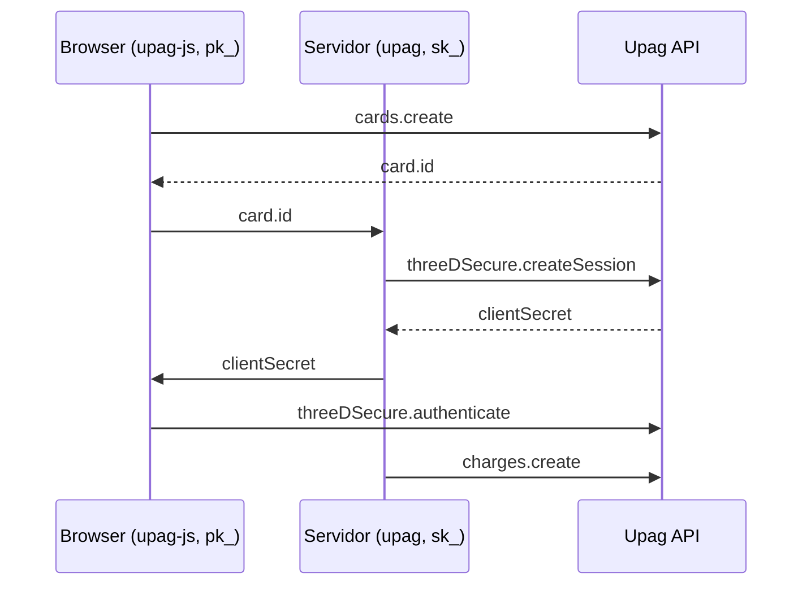

Duas bibliotecas npm falam com a mesma API Upag, com tipos TypeScript e erros padronizados. Os contratos HTTP completos ficam na aba **Referência**.

| npm | Repositório | Runtime | Chave |
| --- | ----------- | ------- | ----- |
| [`upag`](https://www.npmjs.com/package/upag) | [upag-node](https://github.com/upaghq/upag-node) | Node.js 16+ | `sk_...` (secreta) |
| [`upag-js`](https://www.npmjs.com/package/upag-js) | [upag-js](https://github.com/upag/upag-js) | Browser | `pk_...` (publicável) |

## Qual pacote usar

<CardGroup cols={2}>
  <Card title="Node.js (upag)" icon="node-js" color="#68A063" href="./server">
    Cobranças, clientes, produtos, faturas, assinaturas, checkout, transferências, subcontas, apps e webhooks no servidor.
  </Card>
  <Card title="Browser (upag-js)" icon="browser" color="#06AEDD" href="./frontend">
    Tokenização de cartão, 3D Secure, checkout do pagador e antifraude no client.
  </Card>
</CardGroup>

## Host e ambiente

A API é única. Os SDKs escolhem o host pelo prefixo da chave:

| Chave | Host |
| ----- | ---- |
| `sk_test_...` / `pk_test_...` | `https://api.upag.dev/v1` (sandbox) |
| Qualquer outra (`sk_live_...` / `pk_live_...`) | `https://api.upag.io/v1` (produção) |

Passe `baseURL` para sobrescrever o host (por exemplo `http://localhost:3000/v1` em desenvolvimento local). Veja [Autenticação](../guides/authentication).

## Como os dois se combinam

| Tarefa | Onde | Método |
| ------ | ---- | ------ |
| Tokenizar cartão | Browser | `upag.cards.create` (`upag-js`) |
| Abrir sessão 3DS | Servidor | `upag.threeDSecure.createSession` (`upag`) |
| Autenticar no banco | Browser | `upag.threeDSecure.authenticate` (`upag-js`) |
| Criar cobrança | Servidor | `upag.charges.create` (`upag`) |
| Criar link de pagamento ou sessão | Servidor | `upag.paymentLinks.create`, `upag.checkoutSessions.create` (`upag`) |
| Abrir e pagar o checkout do pagador | Browser | `upag.checkout.start`, `confirm` (`upag-js`) |
| Validar entrega de webhook | Servidor | `upag.webhooks.validateSignature` (`upag`) |

## Dúvidas comuns

<Accordion title="Preciso de SDK?">
  Não. Requisições `Authorization: Bearer` com JSON contra a Referência são suficientes. Os SDKs adicionam tipos, seleção de host, `Idempotency-Key`, erros padronizados e a validação de assinatura de webhook.
</Accordion>

<Accordion title="Onde guardar cada chave?">
  A secreta (`sk_...`) fica apenas no backend. A publicável (`pk_...`) pode ir no bundle do front. Não versione chaves em git.
</Accordion>

<Accordion title="O que o browser pode fazer com uma chave publicável?">
  Tokenizar cartões, concluir 3D Secure e, com o código de um link de pagamento, abrir e pagar uma sessão de checkout. Criar sessões, produtos, preços ou listar o catálogo exige a chave secreta.
</Accordion>

<Accordion title="Algum método está só na próxima versão?">
  Alguns recursos recentes (subcontas, apps, `webhooks.validateSignature` e teste grátis no `upag`; `checkout.startShopify`, `checkout.listApps` e teste grátis no `upag-js`) estão no `Unreleased` dos changelogs. Confira a versão instalada.
</Accordion>

## Docs relacionadas

<CardGroup cols={2}>
  <Card title="Quickstart" icon="rocket" href="../guides/quickstart">
    Primeira cobrança com `upag`.
  </Card>
  <Card title="Cartão com 3DS" icon="credit-card" href="../guides/card-3ds">
    Fluxo completo browser + servidor.
  </Card>
  <Card title="Webhooks" icon="webhook" href="../webhooks/overview">
    Eventos e assinatura.
  </Card>
  <Card title="Simulador" icon="flask" href="../simulator">
    Cartões de teste no sandbox.
  </Card>
</CardGroup>
